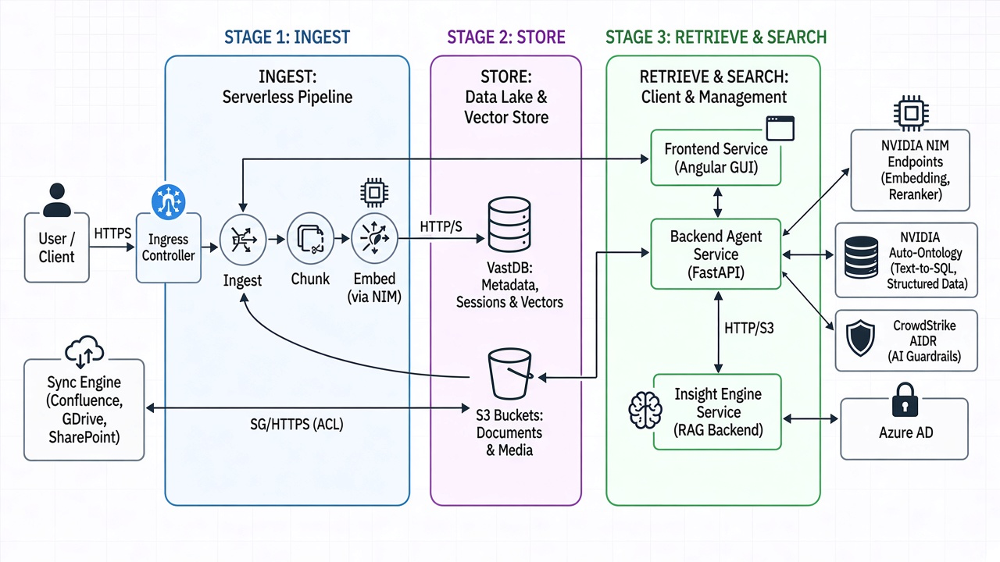

# VAST DataEngine - Research Assistant Blueprint Foundation Stack

An Enterprise RAG-Powered Research Assistant system powered by VAST DataEngine, with flexible LLM provider support (NVIDIA NIM, Google AI Studio, Google Vertex AI), structured-data queries through NVIDIA Auto-Ontology, and CrowdStrike AIDR guardrails.

This Blueprint was created to showcase the end-to-end utilization of the full VAST AI OS production-grade capabilities, including an Agentic Chat Interface, Serverless Event-based Document Ingestion, and VastDB as the unified Vector-Store for both document storage and conversation persistence.

## Overview

The system has two main parts:
1. **K8s Application** - Chat UI and Agent API (Kubernetes)
2. **InsightEngine Pipeline** - Serverless document ingestion (VAST DataEngine)



---

## Deployment

| Component | Guide |
|-----------|-------|
| **K8s Application** (Backend Agent, Frontend GUI) | [k8s-application](deployments/k8s-application/README.md) |
| **InsightEngine Pipeline** (Document Ingestion) | [insight-engine-pipeline](deployments/insight-engine-pipeline/README.md) |


---

## Key Features

| Feature | Description | Documentation |
|---------|-------------|---------------|
| **RAG Q&A** | Retrieval-augmented generation on document collections | [backend](source-code/backend/README.md) |
| **Streaming Responses** | Real-time token streaming with tool execution visibility | [backend](source-code/backend/README.md) |
| **Document Upload** | Single/multi-file and directory upload via GUI | [gui](source-code/gui/README.md) |
| **Collection Management** | Create and manage document collections | [gui](source-code/gui/README.md) |
| **Internet Search** | Optional DuckDuckGo web search augmentation | [backend](source-code/backend/README.md) |
| **NVIDIA Auto-Ontology** | Natural-language questions over structured databases (text-to-SQL), combined with RAG on documents | [below](#nvidia-auto-ontology-structured-data) |
| **CrowdStrike AIDR** | AI guardrails that screen prompts, tool results, and answers for injection, PII, and secrets | [below](#crowdstrike-aidr-ai-guardrails) |
| **Flexible LLM** | NVIDIA NIM, Google AI Studio (Gemini), or Google Vertex AI | [backend](source-code/backend/README.md) |
| **Authentication** | JWT auth with optional Azure AD SSO | [k8s-application](deployments/k8s-application/README.md) |

---

## Component Documentation

| Component | Description |
|-----------|-------------|
| [backend](source-code/backend/README.md) | FastAPI agent service with RAG, streaming, session management |
| [gui](source-code/gui/README.md) | Angular chat UI with collection selector, citations, tool blocks |

---

## LLM Provider Configuration

The application supports three LLM providers, controlled by the `MODEL_PROVIDER` environment variable:

| Provider | Value | Description |
|----------|-------|-------------|
| **NVIDIA NIM** | `nvidia` (default) | OpenAI-compatible API — local GPU (vLLM/NIM) or NVIDIA cloud |
| **Google AI Studio** | `gemini` | Google's Gemini API using an API key |
| **Google Vertex AI** | `vertex` | Google Cloud Vertex AI using a GCP service account |

For detailed setup instructions per provider (including Vertex AI service account configuration), see the [K8s Application Guide](deployments/k8s-application/README.md).

---

## Chat Modes

The chat bar has four mutually exclusive mode toggles (the same choice is also available under **Settings → App Settings**):

| Mode | What it does |
|------|--------------|
| **Internet Search** | Adds DuckDuckGo web search to the agent's tools |
| **Deep Research** | Multi-step planning with several targeted knowledge-base searches |
| **NVIDIA Auto-Ontology** | Adds structured-database queries alongside RAG (see below) |
| **AIDR** | Screens the conversation with CrowdStrike AIDR (see below) |

### NVIDIA Auto-Ontology (structured data)

NVIDIA Auto-Ontology lets the agent answer questions from structured databases in plain language. When the mode is on, the agent gets a `query_database` tool: it sends a natural-language question to the Auto-Ontology service, which generates SQL, runs it, and returns the rows. The GUI shows the pipeline steps live, the generated SQL, and the result table.

The agent decides on its own which source to use: numbers, counts, cohorts, and rankings go to the database; narrative content (notes, reports, documents) goes to RAG; and questions about a single entity typically use both, with the results reconciled in one answer. The built-in Auto-Ontology system prompt is written for the TinyEHR clinical demo (schema `tinyehr_mimic`); for other datasets, adjust it in **Settings → System Prompt** or via `GSF_INSTRUCTIONS`.

| Variable | Description |
|----------|-------------|
| `GSF_BASE_URL` | Auto-Ontology API URL, e.g. `http://<host>:3001`. Leave empty to disable the feature. |
| `GSF_TARGET_DB` | Database name configured in Auto-Ontology to query (e.g. `gsf-bucket`) |
| `GSF_API_KEY` | Only needed when going through the gateway on port 3000; port 3001 needs no key |
| `GSF_MAX_SECONDS` | Wall-clock limit per query before it is abandoned (default `150`) |

### CrowdStrike AIDR (AI guardrails)

CrowdStrike AIDR (AI Detection and Response) checks the conversation at three points:

1. **User prompt** — before the agent runs. A blocked prompt stops the request.
2. **Tool results** — RAG chunks, search results, and database rows, to catch indirect prompt injection. A blocked result is withheld from the model.
3. **Final answer** — after the agent finishes. A blocked answer is flagged in the chat.

Every check appears in the chat as an AIDR block showing which detectors fired and why.

AIDR runs only when **both** `CS_AIDR_ENABLED=true` is set on the backend **and** the AIDR mode is selected in the chat (off by default).

| Variable | Description |
|----------|-------------|
| `CS_AIDR_ENABLED` | Master switch (`true` / `false`, default `false`) |
| `CS_AIDR_BASE_URL` | CrowdStrike AIDR API base URL |
| `CS_AIDR_TOKEN` | AIDR API token (treat as a secret) |
| `CS_AIDR_APP_ID` | Application ID reported to AIDR (default `research-assistant`) |

Current limitations:
- If the AIDR API is unreachable or returns an error, the request continues unchecked (fail-open); the failure is only logged.
- The final answer is checked after it has been streamed, so a blocked answer is flagged rather than hidden.
- Only the first 4,000 characters of each answer or tool result are checked.
- AIDR applies to the streaming chat endpoint (`/api/v1/prompt/stream`) used by the GUI, not to `/api/v1/prompt`.

---

## Pipeline Flow

```
Upload Document → S3 bucket
                      ↓
              InsightEngine Ingest
              (chunk, embed, store)
                      ↓
                 VastDB (vectors)
                      ↓
               Search Ready (RAG)
                      ↓
          Agent retrieves & answers
```

---

## Need Help?

- **K8s Deployment**: See [K8s Application Guide](deployments/k8s-application/README.md)
- **InsightEngine**: See [Pipeline Guide](deployments/insight-engine-pipeline/README.md)
- **Community**: [VAST Community Forums](https://community.vastdata.com/)
